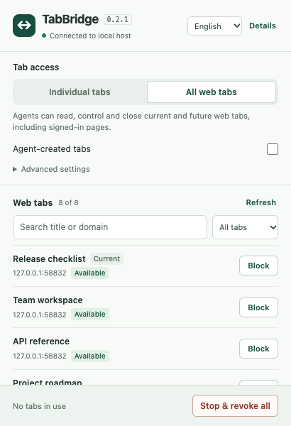

# TabBridge

**Your Chrome, connected to your CLI.**

TabBridge is an independent, local browser automation toolkit for Codex CLI and other MCP clients. It connects to the Chrome profile you already use, with explicit tab grants, separate agent sessions, compact accessibility snapshots and real browser input.

[简体中文](README.zh-CN.md) · [Security model](docs/SECURITY.md) · [Architecture](docs/ARCHITECTURE.md) · [Agent guide](docs/AGENT_GUIDE.md) · [Troubleshooting](docs/TROUBLESHOOTING.md)

> **Early release (0.2).** This is an independently implemented project, not an OpenAI plugin or an official compatibility layer. It does not connect to private ChatGPT pipes, copy official plugin code, or bypass their authorization checks.



## What works

- Connect an existing Chrome profile through Chrome Native Messaging. No debug TCP port or cloud relay.
- Share individual user tabs. Claim a tab for one CLI/MCP session; other sessions cannot operate it.
- Or enable **All web tabs** once: CLI/MCP can discover and automatically claim all current and future HTTP(S) tabs, with per-tab Block/Allow controls.
- Optionally let agents create their own background tabs. User tabs are retained during routine cleanup; All web tabs also permits explicitly requested closure.
- Activate an authorized tab and focus its Chrome window, restoring a minimized window when a page needs foreground rendering or a user handoff.
- Read compact accessibility snapshots, use element references, and request state differences.
- Click, fill, select, press keys, scroll, navigate, wait for text, and inspect JavaScript dialogs.
- Hover menus and drag between current element refs using HTML5 or pointer input.
- Use modifier key combinations and select explicit local files in file inputs.
- Read bounded rendered page text, optionally from a current element ref.
- Capture viewport, full-page or element PNGs and read bounded in-memory console messages.
- Explicitly capture up to 100 recent HTTP(S) request metadata records for troubleshooting.
- Batch predictable actions and return a fresh snapshot. Partial failures identify completed steps.
- Opt into arbitrary JavaScript evaluation for development, independently from ordinary browsing.
- Reconnect after the native host exits. Never automatically replay a write with an uncertain outcome.
- Use the same browser through a standalone CLI or an MCP stdio server.

## Requirements

- Node.js **22+**
- Chrome **118+** (current stable recommended)
- macOS or Linux; macOS is the first validated platform

Windows native transport is not implemented. Chrome's protected pages and browser security dialogs are not automation targets.

## Install from source

```sh
git clone https://github.com/cjiewong/tabbridge.git
cd tabbridge
node bin/tabbridge.mjs setup
```

The runtime has **zero npm dependencies**. `npm install` is only needed for development/tests. Keep this checkout in place: the native host wrapper references its absolute path and your current Node executable. Rerun `setup` after moving the checkout or replacing Node.

1. Open `chrome://extensions` and enable **Developer mode**.
2. Choose **Load unpacked**, selecting this repository's `extension/` directory.
3. Pin TabBridge, open its popup, and press **Connect**.
4. Press **Share** beside a tab you want an agent to use, or enable **All web tabs** to allow CLI/MCP access without individual sharing. Both include page content and frames.
5. Run `node bin/tabbridge.mjs doctor`.

All-web-tabs access, agent-created tabs and developer JavaScript are **off by default**. Enable them individually in the popup if needed. **Stop & revoke all** disconnects the bridge and disables all three options.

The popup follows Chrome’s interface language (Chinese or English); the language selector saves an explicit preference. Select **Individual tabs** or **All web tabs** for access, and expand **Advanced settings** for JavaScript evaluation. Search by title/domain or filter **In use** / **Blocked**. Each row retains its domain and shows its access state; **In use** means a session owns the tab, not that a command is currently executing. The current web tab appears first, and the stop control stays visible while the list scrolls. **Details** shows connection/version information and copies a diagnostic summary without page titles, URLs or session IDs.

### Access all tabs without sharing individually

Enable **All web tabs** in the popup. CLI/MCP then discovers all HTTP(S) tabs in the connected Chrome profile, including existing signed-in pages and tabs opened later. The first ordinary action automatically claims the tab for its session; no individual Share or explicit claim is necessary. The setting persists across Chrome restarts and allows cross-origin web navigation. Chrome internal pages and tabs held by other sessions remain excluded.

Use **Block** beside a tab to exclude it; **Allow** restores eligibility. These tab-specific blocks last for that browser session/tab lifetime. Turning the global option off revokes globally acquired leases and restores individual sharing, while preserving valid manual grants and agent-owned tabs. Stop also turns the option off. All web tabs also permits closing user-owned tabs controlled by the requesting session. With the option off, only agent-created tabs can be closed. Agents should close user tabs only when requested.

Setup only registers `io.github.cjiewong.tabbridge` in your user-level Chrome Native Messaging directory. It does not alter other extensions or their native hosts. You can select `--browser chromium`, `--browser edge`, or `--browser testing`; these registration paths require testing on your platform. The testing option targets Chrome for Testing 146+ with its separate host registration location.

For connection errors, session conflicts and tab access failures, see [Troubleshooting](docs/TROUBLESHOOTING.md). Keep `doctor` output private until you redact personal paths.

## Codex CLI / MCP

Run `setup` to print the exact absolute paths for your machine, then add:

```toml
[mcp_servers.tabbridge]
command = "/absolute/path/to/node"
args = ["/absolute/path/to/tabbridge/bin/tabbridge.mjs", "mcp"]
```

Or use Codex's MCP registration command with the corresponding absolute paths:

```sh
codex mcp add tabbridge -- /absolute/path/to/node /absolute/path/to/tabbridge/bin/tabbridge.mjs mcp
```

Start a new CLI session after registration. Example instruction:

> Use TabBridge. List the tabs I shared, claim the relevant tab, inspect its snapshot, fill the form with the details I provided, then show me the result. Keep the tab open.

Each MCP process gets a distinct session by default. Use `mcp --session task-name` only when you intentionally want processes to share ownership. [Agent usage guide](docs/AGENT_GUIDE.md) explains references, batches and cleanup.

## CLI

Commands print JSON. Use an explicit session name for each independent task:

```sh
node bin/tabbridge.mjs tabs --session research
node bin/tabbridge.mjs claim 123 --session research
node bin/tabbridge.mjs snapshot 123 --session research
# Use the actual reference returned by that snapshot:
node bin/tabbridge.mjs click 123 s1:e7 --session research
node bin/tabbridge.mjs snapshot 123 --diff --session research
node bin/tabbridge.mjs screenshot 123 --out page.png --session research
node bin/tabbridge.mjs release 123 --session research
```

For agent-created tabs, enable the popup option first:

```sh
node bin/tabbridge.mjs open https://example.com --session demo
# Inspect and operate the returned tab ID, then close it if disposable.
node bin/tabbridge.mjs close 456 --session demo
```

Run `tabbridge help` (or `node bin/tabbridge.mjs help`) for command syntax, and `tools` for complete MCP tool schemas. `--json` accepts structured parameters for batches and advanced operations.

### Menus, files, reading and diagnostics

Use the actual refs returned by the latest snapshot:

```sh
node bin/tabbridge.mjs hover 123 s1:e7 --session research
node bin/tabbridge.mjs snapshot 123 --session research
# Drag only between refs from that current snapshot:
node bin/tabbridge.mjs drag 123 s2:e8 s2:e12 --session research
node bin/tabbridge.mjs press 123 Control+A --session research
node bin/tabbridge.mjs read 123 --json '{"maxChars":12000}' --session research
node bin/tabbridge.mjs screenshot 123 --full-page --out page.png --session research
node bin/tabbridge.mjs screenshot 123 --json '{"ref":"s2:e8"}' --out element.png --session research
# Selecting files can trigger an immediate website upload. Authorize the destination/files first.
node bin/tabbridge.mjs upload 123 s2:e15 /absolute/path/to/approved-file.txt --session research
node bin/tabbridge.mjs network 123 --json '{"action":"start"}' --session research
node bin/tabbridge.mjs network 123 --session research
node bin/tabbridge.mjs network 123 --json '{"action":"stop"}' --session research
```

`read` returns rendered text with a truncation flag, up to 32,000 characters. It does not traverse out-of-process frames. `upload` accepts up to 16 absolute local file paths; use `--json '{"files":[]}'` with a file-input ref to clear the selection. It selects files without pressing a separate submit button, but sites may upload on selection.

Network capture is explicit and bounded, omits headers/bodies and removes queries/fragments/credentials from URLs. Request paths can still contain private information. Capture is cleared on release, revocation or debugger detach; a stop retains its bounded records until then. Screenshot limits are 16,384 pixels per side, 32 million pixels and the existing image-message size cap. Choose `fullPage` or an element ref rather than combining them. See the [feature comparison](docs/FEATURE_COMPARISON.md) for the scope relative to other browser MCP projects.

### Foreground dialogs and user handoffs

`browser_activate` (CLI: `activate TAB`) selects the target tab and brings its Chrome window forward. It uses the same tab grants, exclusions and session ownership as other actions; JavaScript evaluation is not required. Snapshots report `active` and `windowFocused` so agents can distinguish a selected tab from a focused browser window.

```sh
node bin/tabbridge.mjs activate 123 --session research
node bin/tabbridge.mjs snapshot 123 --session research
```

Activation changes your foreground window, so use it when the task needs it. Read a fresh snapshot afterward: sites may render dialogs or enable controls only once visible/focused. Activation does not reload the page, repeat a prior click, accept a dialog or bypass verification. OS focus restrictions and site bugs can still require manual attention.

## Connection and permissions

```text
CLI / MCP process
    │ per-user Unix socket (0600, parent directory 0700)
    ▼
Native host (started by Chrome)
    │ Chrome Native Messaging
    ▼
TabBridge extension
    │ explicit tab grant / agent-created tab ownership
    ▼
Chrome tabs + debugger APIs
```

Individual user-tab grants are scoped to the current top-level origin. Cross-origin navigation revokes them unless All web tabs is active. Individual grants survive a native-host reconnect but expire when Chrome restarts; the global access setting persists. With global access off, a user-shared tab requires `claim` before use. Other sessions do not see claimed tabs in either mode.

The local socket is trusted at the **OS-user boundary**: another process running as you can act as a client. Session names prevent accidental collisions, not hostile same-user impersonation. Never expose this socket over a network. See [Security](docs/SECURITY.md).

## Development

```sh
npm ci
npm run check
npm test
npx playwright install chromium
npm run test:e2e
npm run test:package
npm run pack:extension
```

E2E tests use a disposable Chrome profile, a local fixture website and a profile-specific Native Messaging manifest. They do not read your ordinary browser profile. Set `TABBRIDGE_TEST_CHROME` to an existing Chrome for Testing executable to reuse it. Set `TABBRIDGE_TEST_HEADED=1` to watch the tests. Development packaging requires `zip`, `unzip` and `tar`; E2E host restart checks use `lsof`. See [Contributing](CONTRIBUTING.md) for Linux browser dependencies.

After updating the checkout, reload TabBridge in `chrome://extensions` and restart the MCP client session to refresh its tool list. Inspect access again after a reload before resuming an interrupted task.

The package smoke check extracts an actual npm tarball and runs CLI/setup/uninstall in a temporary directory, without runtime dependencies or a live browser. `npm run pack:release` builds the extension ZIP and CLI tarball with SHA-256 files under `dist/`; it does not publish anything. See [Releasing](docs/RELEASING.md).

## Continuous integration

The checked-in [GitHub Actions workflow](https://github.com/cjiewong/tabbridge/blob/main/.github/workflows/ci.yml) runs checks and unit tests on Node.js 22/24 and macOS/Ubuntu, plus real-browser and packed-distribution tests. Actions are pinned to commit SHAs, run with read-only repository permissions, and need no production secrets. Release artifacts are built only after the test jobs pass; there is no automated publication.

Workflow configuration is not evidence of a successful hosted run. Consult [Actions](https://github.com/cjiewong/tabbridge/actions) for hosted results and [Validation](docs/VALIDATION.md) for the locally tested environments.

## Contributing and support

Use [issues](https://github.com/cjiewong/tabbridge/issues) for reproducible bugs and feature requests. Read [Contributing](CONTRIBUTING.md), the [code of conduct](CODE_OF_CONDUCT.md) and [maintainer guidance](docs/MAINTAINING.md) before proposing larger changes. Vulnerabilities belong in [private security reports](SECURITY.md), not public issues with exploit details. This is a community project without a support SLA.

## Known limits

- This release is not feature parity with ChatGPT's browser integration. Side chat, official tab mentions and ChatGPT history synchronization are outside scope.
- Out-of-process/cross-origin iframe element targeting, download management, remote-file uploads, native file chooser handling, mobile emulation and persistent DOM references across navigation are not yet supported as dedicated tools.
- Snapshot refs expire on the next snapshot or navigation. Diff output includes a fresh reference map.
- Drags require both refs in one viewport; file dragging is unsupported. Chrome debug-attachment conflicts and protected targets produce explicit errors.
- A timeout does not prove a write failed. Inspect the page before retrying; batch errors can mean partial completion.
- Agents remain responsible for obtaining user authorization for consequential actions. A tab grant is permission to access the page, not permission to purchase, publish, delete data or change credentials.

## Uninstall

Disconnect in the popup, run `node bin/tabbridge.mjs uninstall`, then remove TabBridge from `chrome://extensions`. Website data, cookies and browsing history are not deleted.

## License and provenance

MIT. Independently implemented using public Chrome extension and CDP APIs and the MCP specification. Architectural inspiration includes [codex-browser-bridge](https://github.com/DeliciousBuding/codex-browser-bridge). No OpenAI extension, runtime or proprietary source is included. TabBridge is not affiliated with OpenAI or Google.
